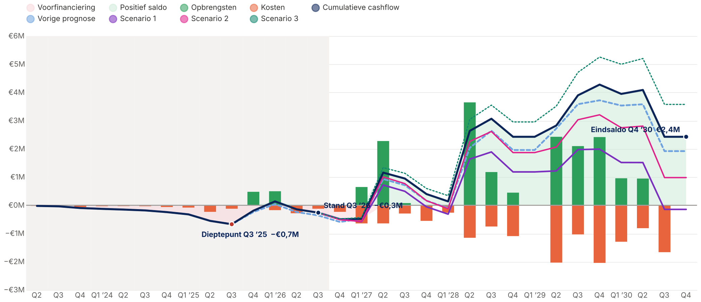

# Cashflow-template voor Power BI

Een template voor een cashflowgrafiek per kwartaal in Power BI:

- **balken**: opbrengsten (groen, boven de nullijn) en kosten (oranje, eronder)
- **lijnen**: cumulatieve cashflow (dik, donkerblauw), vorige prognose (stippellijn) en maximaal drie scenario's
- **vlakken**: positief saldo (lichtgroen) en voorfinanciering (lichtroze, saldo onder nul)
- **grijze achtergrond** voor de realisatieperiode
- **markeringen**: dieptepunt, stand aan het eind van de realisatie en eindsaldo, met label in `€ … M`

## Inhoud

| Bestand | Doel |
|---|---|
| `Cashflow_Template.xlsx` | Invoerbestand met voorbeelddata (tabbladen *Uitleg*, *Cashflow*, *Instellingen*) |
| `power_query.m` | Power Query-code voor de queries `Cashflow` en `Instellingen` |
| `dax/model.dax` | Kalender, slicertabel voor scenario's en alle measures |
| `deneb/cashflow_vegalite.json` | De grafiek als Vega-Lite-spec voor de custom visual **Deneb** |
| `deneb/voorbeeld_deneb_dataset.json` | Voorbeeld van de rijen die Deneb ontvangt (om de spec buiten Power BI te testen) |
| `scripts/genereer_voorbeelddata.py` | Maakt het Excel-bestand en de JSON met voorbeelddata opnieuw aan |

> **Waarom Deneb?** De standaardvisual *Lijn- en gestapeld kolomdiagram* kan balken en lijnen combineren, maar geen gekleurde vlakken boven/onder nul, geen achtergrond voor de realisatieperiode en geen automatische labels bij dieptepunt en eindsaldo. Deneb is een gecertificeerde, gratis visual uit AppSource die dat wel kan.

## Invulling van de data

Tabblad **Cashflow** (Excel-tabel `tblCashflow`), één rij per kwartaal per versie:

| Kolom | Inhoud |
|---|---|
| `Kwartaal` | Een datum in het kwartaal (wordt naar de eerste dag van het kwartaal gezet) |
| `Versie` | `Actueel`, `Vorige prognose`, `Scenario 1`, `Scenario 2` of `Scenario 3` |
| `Opbrengsten` | Bedrag in euro's |
| `Kosten` | Bedrag in euro's; positief of negatief invoeren maakt niet uit |

- **Actueel**: realisatie tot en met de realisatiedatum, daarna de huidige prognose.
- **Vorige prognose**: de volledige reeks van de vorige versie.
- **Scenario's**: alleen de kwartalen ná de realisatiedatum. Het scenario begint bij de actuele stand.
- Meerdere regels per kwartaal en versie (bijvoorbeeld per project of kostensoort) worden opgeteld.

Tabblad **Instellingen**: `RealisatieTotEnMet` is een datum in het laatste gerealiseerde kwartaal.

## Stappen in Power BI Desktop

1. **Data laden**: *Gegevens transformeren* → *Nieuwe bron* → *Lege query* → *Geavanceerde editor*. Plak de twee queries uit `power_query.m` en geef ze de namen `Cashflow` en `Instellingen`. Pas `BronPad` aan (of gebruik een parameter, of vervang de bron door SharePoint, SQL of een andere bron).
2. **Kalender en slicertabel**: *Modellering* → *Nieuwe tabel* → plak `Kalender` en `Scenario keuze` uit `dax/model.dax`.
3. **Relatie**: `Kalender[Datum]` (1) → `Cashflow[Kwartaal]` (*). Markeer `Kalender` als datumtabel en zet `Kalender[Realisatie]` op *Niet samenvatten*.
4. **Measures**: maak alle measures uit `dax/model.dax`. Houd de namen precies zo (`Opbrengsten`, `Kosten`, `Cumulatieve cashflow`, `Vorige prognose`, `Scenario 1`, `Scenario 2`, `Scenario 3`), want de grafiek verwijst ernaar.
5. **Deneb installeren**: in het deelvenster Visualisaties → `…` → *Meer visuals ophalen* → zoek **Deneb** → *Toevoegen*.
6. **Visual vullen**: voeg een Deneb-visual toe en sleep in *Values*, in deze volgorde:
   `Kalender[Kwartaal]`, `Kalender[Realisatie]`, `Opbrengsten`, `Kosten`, `Cumulatieve cashflow`, `Vorige prognose`, `Scenario 1`, `Scenario 2`, `Scenario 3`.
7. **Spec plakken**: `…` op de visual → *Bewerken* → kies **Vega-Lite** → *Lege specificatie* → vervang de volledige inhoud door `deneb/cashflow_vegalite.json` → *Toepassen*. Sluit de editor.
8. **Scenario-slicer**: zet een slicer op `'Scenario keuze'[Scenario]`. Is er niets geselecteerd, dan worden er geen scenariolijnen getoond.
9. *(Optioneel)* KPI-kaarten met `Dieptepunt`, `Dieptepunt kwartaal`, `Stand realisatie` en `Eindsaldo`.
10. Sla het bestand op als **Power BI-sjabloon (.pbit)** via *Bestand* → *Exporteren* → *Power BI-sjabloon*. Daarna kun je het als template hergebruiken.

## Aanpassen

Alles staat in `deneb/cashflow_vegalite.json`:

- **Kleuren**: de `range`-lijst bij `color.scale`. Die staat drie keer in de spec, één keer per laag, en de lijsten moeten gelijk blijven. De volgorde volgt de `domain`-lijst ernaast.
- **Lijnstijl**: `strokeDash` (stippelpatroon) en `strokeWidth` in de lijnenlaag.
- **Balkbreedte**: `"width": {"band": 0.55}` in de balkenlaag.
- **Markeringen**: de laatste laag. `_markering` bepaalt welke punten een label krijgen; `dx` en `dy` bepalen waar het label staat.
- **Labels op de y-as**: `config.axisY.labelExpr` toont bedragen in miljoenen (`€2M`). Voor duizenden vervang je `/ 1e6` door `/ 1e3` en `'M'` door `'K'`.

Werk je met andere versienamen of meer scenario's? Pas dan de filters in de measures aan en voeg de nieuwe measure toe aan de `fold`-lijst, aan `domain` en aan `range` in de spec.

## Opmerkingen

- De legenda toont alle series, ook scenario's die op dat moment uit staan. Wil je dat niet, haal de scenario's dan uit de `domain`- en `range`-lijsten. Ze krijgen dan automatisch een kleur.
- Opbrengsten en kosten van een scenario zie je niet als balken. De balken tonen altijd de versie `Actueel`.
- Deneb zet getallen in de tooltip in Engelse notatie (`1,234,567`). De labels in de grafiek zijn wel in Nederlandse notatie.
- Testen buiten Power BI kan in de [Vega-editor](https://vega.github.io/editor/). Vervang daarvoor `"data": {"name": "dataset"}` door `"data": {"values": [...]}` met de inhoud van `voorbeeld_deneb_dataset.json`.
